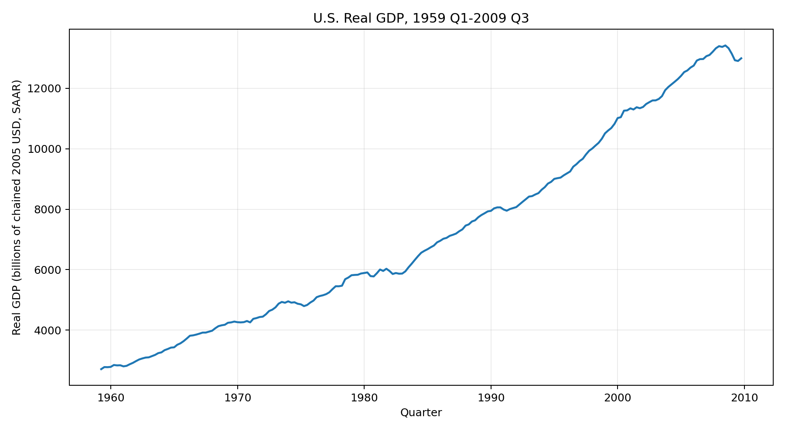
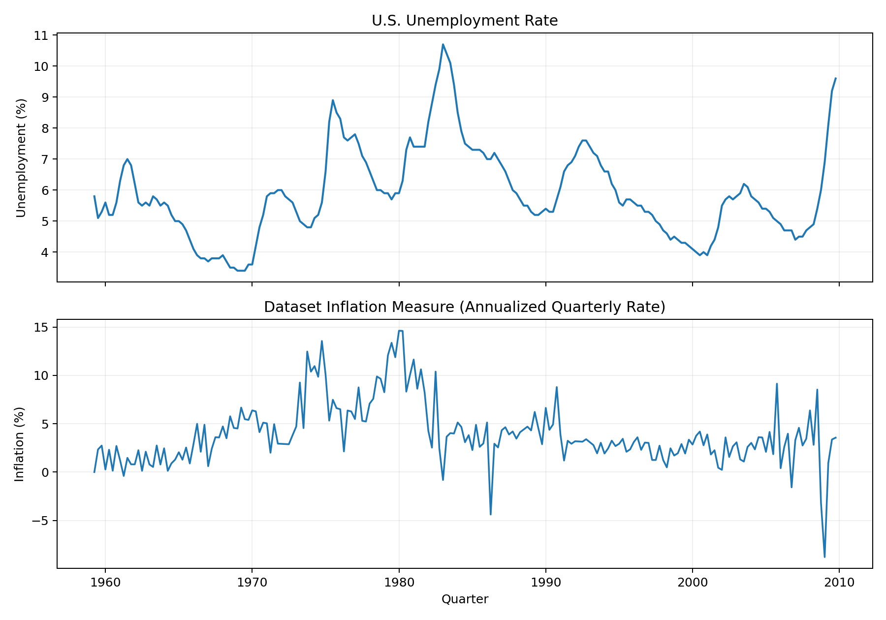
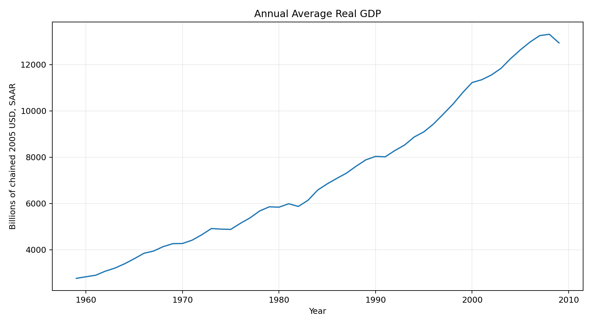

# U.S. Macroeconomic Trends Analysis (1959 Q1-2009 Q3)

A reproducible Python + SQL analysis of historical U.S. economic indicators. The repository includes the original dataset snapshot used in the analysis, a cleaning/feature-engineering pipeline, SQLite queries, exported tables, and charts.

## Dataset and provenance

- **Dataset:** U.S. Macroeconomic Data, 203 quarterly observations from 1959 Q1 through 2009 Q3, with 14 variables.
- **Included file:** `data/raw/us_macrodata.csv`.
- **Original sources:** the dataset was compiled by Skipper Seabold. Most series came from FRED, Federal Reserve Bank of St. Louis; the unemployment-rate series came from the U.S. Bureau of Labor Statistics. The original source metadata says the data were accessed on 15 December 2009.
- **License stated by the dataset maintainer:** public domain.
- **Variable coverage:** real GDP, consumption, investment, government expenditure, disposable income, CPI, M1, 3-month Treasury bill rate, unemployment, population, inflation, and real interest rate.

The historical data are intentionally not presented as current economic statistics. They stop at 2009 Q3.

## Visual results







## Questions explored

1. How did real GDP change over the sample period?
2. How did unemployment and inflation move over time?
3. Which quarters recorded the highest unemployment values in this dataset?
4. How do annual average GDP, unemployment, and inflation vary over time?
5. What simple pairwise correlations appear among selected macro indicators?

## Results from the included run

The included `outputs/executive_summary.txt` is generated by the script. On the bundled data snapshot, it reports 203 usable quarterly rows from 1959 Q1 to 2009 Q3, a 379.3% increase between first and last real-GDP observations, a maximum unemployment rate of 10.7% in 1982 Q4, and mean of 3.96% for the dataset's annualized quarterly inflation field. These are descriptive calculations over the defined historical sample.

## Tools

Python, pandas, NumPy, Matplotlib, SQLite, SQL.

## Run locally

Python 3.10+ is recommended.

```bash
python -m venv .venv
# Windows: .venv\\Scripts\\activate
# macOS/Linux:
source .venv/bin/activate
pip install -r requirements.txt
python analyze.py
```

No external download or API key is required: the authentic historical CSV used in the analysis is included in `data/raw/`.

## Generated outputs

After running, the `outputs/` directory contains:

- `us_macrodata.sqlite` - SQLite database with the `quarterly_macro` table.
- `quarterly_metrics.csv` - cleaned quarterly records and derived GDP/CPI growth measures.
- `annual_summary.csv` - annual averages queried from SQLite.
- `highest_unemployment_quarters.csv` - ten highest-unemployment quarters.
- `latest_observation.csv` - final observation in the historical sample.
- `correlation_matrix.csv` - pairwise correlations for selected fields.
- `executive_summary.txt` - reproducible headline statistics.
- `real_gdp_trend.png`, `unemployment_inflation.png`, `annual_real_gdp.png` - charts.

## SQL practice

The standalone SQL examples are in `sql/analysis_queries.sql`. Run `analyze.py` first to create the SQLite database, then open it with DB Browser for SQLite or run the statements from Python/SQLite CLI.

## Method and caveats

- Numeric fields are parsed explicitly; rows without core time/indicator fields are removed, and duplicate year-quarter records are dropped.
- GDP quarter-over-quarter and year-over-year percentage changes are calculated from the real GDP series. CPI year-over-year change is also calculated.
- The supplied `infl` field is retained as published in the dataset; its documentation defines it as an annualized quarterly inflation rate derived from CPI.
- These are descriptive analyses, not causal claims or a forecast. Historical definitions and base years (including chained 2005 dollars) are preserved.

## License

The analysis code is released under the MIT License in this repository. The Statsmodels dataset documentation identifies the bundled historical macrodata snapshot as public domain; retain the source attribution below when redistributing it.

## Citation

Seabold, S. (dataset compiler). *United States Macroeconomic Data, 1959 Q1-2009 Q3*. Data sourced primarily from FRED, Federal Reserve Bank of St. Louis, with unemployment data from the U.S. Bureau of Labor Statistics. The dataset documentation is included in the Statsmodels Datasets documentation: <https://www.statsmodels.org/stable/datasets/generated/macrodata.html>.

## Suggested GitHub repository name

`us-macroeconomic-trends-analysis`
